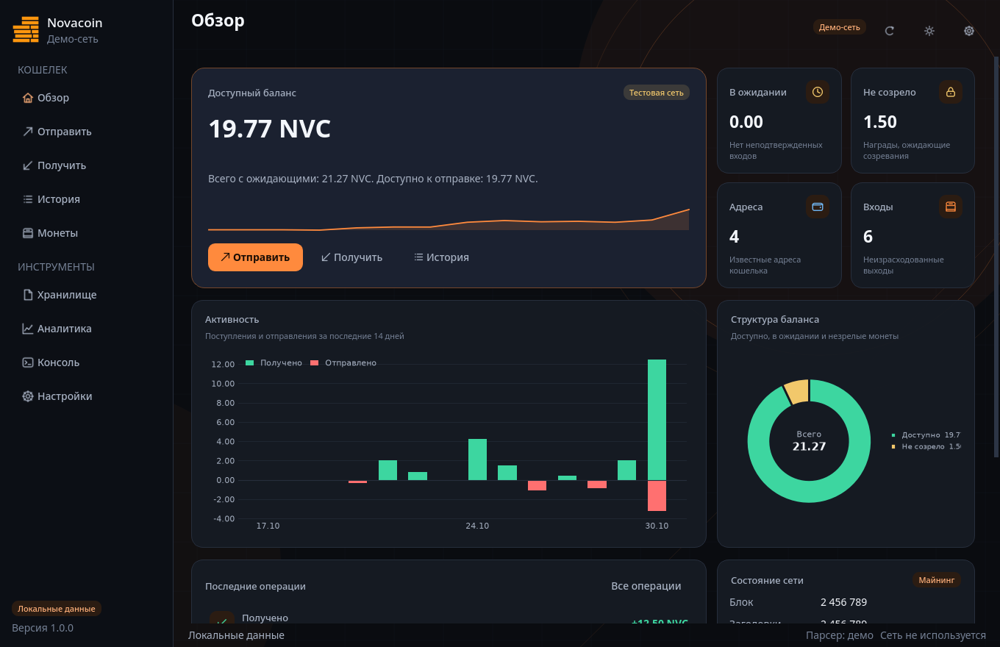
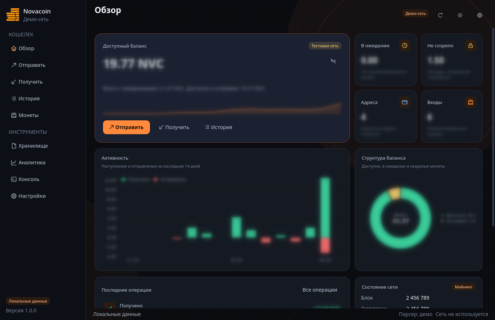
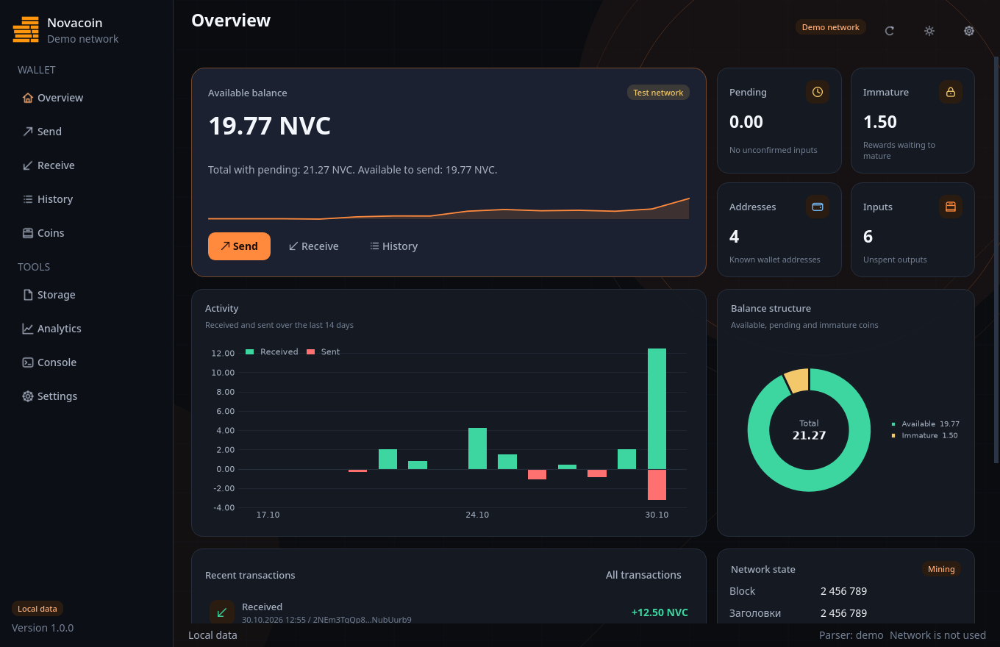

# Phoenix Wallet GUI

Графический клиент кошелька Phoenix на PyQt6. Работает поверх локального
HTTP-прокси `main.py`, который, в свою очередь, общается с `novacoind`.
Приватные ключи и подпись транзакций остаются в Python-прокси: интерфейс
получает только адреса, UTXO и результаты RPC.



Светлая тема и вариант Aurora: [светлая](docs/screenshots/overview-light.png),
[Aurora](docs/screenshots/overview-aurora.png), [настройки](docs/screenshots/settings.png),
[своя палитра](docs/screenshots/settings-custom.png),
[хранилище](docs/screenshots/storage.png), [English interface](docs/screenshots/overview-en.png).

## Возможности

- девять разделов: обзор, отправка, получение, история, монеты, хранилище,
  аналитика, консоль и настройки;
- две модели отправки: обычная (адрес, сумма, комментарий) и экспертная
  (ручной выбор UTXO и расчет сдачи);
- консоль JSON-RPC с автодополнением методов, историей команд и каталогом
  вызовов;
- графики matplotlib: активность, накопительный поток, структура баланса
  и контрагенты;
- темы Novacoin Dark, Aurora и Daylight, свои основные цвета и предпросмотр,
  локальный медиафон с затемнением, размытием и медленным панорамированием;
- живые анимации: подсветка элементов при наведении, переходы между
  страницами и настраиваемая скорость;
- прокрутка страницы колесом поверх графиков, не теряющая жест;
- сортируемые таблицы, поиск, фильтры, экспорт истории в CSV;
- настраиваемая информативность: минимум, стандарт, подробно (включая сырые
  RPC-данные в карточке транзакции);
- подсказки при наведении, сочетания клавиш и справка по ним по клавише F1;
- автоматический запуск `novacoind` в foreground-режиме, проверка RPC-порта
  и корректная остановка процесса при выходе;
- демо-режим с локальными данными для проверки интерфейса без сети;
- русский, английский, немецкий, французский, итальянский и украинский
  интерфейс с возможностью добавлять свои языки.

## Установка

Требуется Python 3.11 или новее. Зависимости интерфейса вынесены отдельно от
криптографических зависимостей прокси.

```bash
python3 -m venv .venv
source .venv/bin/activate
pip install -r requirements-gui.txt
```

На Windows активация окружения выполняется через
`.venv\Scripts\activate.bat`.

## Запуск

```bash
python -m phoenix_gui
```

Демонстрационный режим без прокси и демона:

```bash
python -m phoenix_gui --demo
```

Полезные параметры:

```text
--project PATH      каталог проекта Phoenix (config.toml и novacoind)
--proxy URL         адрес локального прокси
--theme KEY         novacoin (phoenix), aurora или daylight
--reset-settings    сбросить сохраненные настройки
--log-level LEVEL   DEBUG, INFO, WARNING или ERROR
--version           версия приложения
```

## Оформление и анимации

Раздел `Настройки -> Внешний вид` работает по принципу черновика. Тема,
свои цвета, масштаб, скорость и переключатели движения применяются только
после кнопки `Применить`; до этого рядом с ней показывается статус
`Есть непримененные изменения`. Пять основных цветов (фон, панель, карточки,
акцент и текст) подбираются вручную, а производные оттенки, контраст подписей
и состояния наведения рассчитываются автоматически. Если контраст текста и
фона ниже 4.5:1, интерфейс предупреждает об этом.

Главный переключатель `Анимации интерфейса` управляет подсветкой при
наведении, переходами страниц и появлением уведомлений. Скорость задается
в процентах: меньше 100 - быстрее, больше 100 - плавнее. При выключенных
анимациях интерфейс и уведомления появляются сразу, без задержки.

Логотип проекта берется из `nvc_logo png.png` и используется в боковой
панели и как иконка приложения. Если файл недоступен, рисуется запасной
знак Novacoin.

## Приватность

На главной странице рядом с балансом есть кнопка с глазом. Она включает
режим приватности: баланс, суммы, счетчики, таблицы операций, монеты и
графики размываются на всех страницах. Заголовки, навигация и кнопки
остаются четкими, чтобы приложением можно было пользоваться. Повторное
нажатие возвращает данные. Состояние сохраняется между запусками.



## Языки

Язык выбирается в `Настройки -> Внешний вид -> Язык` и применяется сразу,
без перезапуска. В поставку входят русский, английский, немецкий,
французский, итальянский и украинский каталоги. Если в выбранном языке
нет строки, используется английский перевод, затем русский оригинал.

Каталоги лежат в `phoenix_gui/i18n/translations` по одному JSON-файлу на
язык. В настройках можно указать другую папку: кнопка с папкой открывает
проводник, `Обновить` перечитывает каталоги, `Открыть` показывает текущую
папку. Внешняя папка может добавлять новые языки и переопределять встроенные
файлы. Минимальный формат файла:

```json
{
  "code": "es",
  "name": "Spanish",
  "native_name": "Español",
  "strings": {"Настройки": "Ajustes"},
  "patterns": {"^Показано (\\d+) из (\\d+)": "Mostrando {0} de {1}"}
}
```

Ключи `strings` - исходные русские строки, `patterns` - регулярные выражения
для динамических подписей с подстановками `{0}`, `{1}`. Незнакомый файл
пропускается с сообщением в строке состояния, остальные каталоги остаются
доступны.



## Хранилище pstore

Раздел `Хранилище` работает с методами прокси `pstore`, `pload` и `pcancel`.
Файл можно выбрать на диске или указать прямую HTTP(S)-ссылку; после загрузки
интерфейс показывает id графа, число транзакций, размер и якорь. Для получения
нужно ввести id и расширение без точки: прокси соберет файл и сохранит его в
системную папку загрузок. Кнопка отмены удаляет только неподтвержденные
pstore-транзакции из очереди.

## Архитектура

```text
novacoind (C++) -> main.py (Flask, JSON-RPC) -> phoenix_gui (PyQt6)
```

- `phoenix_gui/rpc` - HTTP-клиент, модели ответов и сервисный слой;
- `phoenix_gui/core` - деньги, валидация адресов, подбор входов, запуск
  демона, медиа, звуки, конфигурация и фоновые задачи;
- `phoenix_gui/ui/widgets` - темы, иконки, таблицы, поля, графики и тосты;
- `phoenix_gui/ui/pages` - девять страниц приложения;
- `phoenix_gui/ui/dialogs` - подтверждение отправки, детали транзакции,
  справка по клавишам;
- `phoenix_gui/demo.py` - детерминированный демо-бэкенд;
- `tests` - модульные и интерфейсные тесты;
- `tools/screenshot_gui.py` - генерация скриншотов для документации.

Подробнее о потоке данных и принятых решениях: `docs/architecture.md`.

## Запуск демона

GUI ищет `novacoind` в таком порядке:

1. путь из настроек;
2. переменная окружения `PHOENIX_NOVACOIND`;
3. `bin/novacoind` или `novacoind` в каталоге проекта;
4. `novacoin-master/src/novacoind`;
5. `PATH`.

Если RPC-порт уже слушается другим процессом, GUI считает демон внешним и не
останавливает его при выходе. Прокси `main.py` запускается отдельно: при
старте он запрашивает пароль хранилища ключей, поэтому автоматический запуск
прокси из GUI намеренно не выполняется.

### Сборка novacoind из исходников

В репозитории лежат исходники `novacoin-master`. Для сборки нужны CMake,
компилятор C++17, Boost, Berkeley DB, OpenSSL и liboqs, как для обычного
novacoind. Готовый бинарник не хранится в репозитории.

```bash
python tools/build_daemon.py --jobs 8
```

Скрипт выполнит CMake-сборку цели `novacoind` и положит результат в
`bin/novacoind`. GUI найдет его автоматически. Проверить команды без сборки
можно с флагом `--dry-run`.

## Горячие клавиши

| Клавиши | Действие |
| --- | --- |
| Alt+1 ... Alt+9 | Переход к разделу |
| Ctrl+R, F5 | Обновить текущую страницу |
| Ctrl+Shift+T | Переключить тему |
| Ctrl+, | Настройки |
| F1 | Справка по клавишам |
| Ctrl+Enter | Подтвердить отправку |
| Ctrl+E | Экспорт истории в CSV |
| Ctrl+L | Очистить консоль |
| Ctrl+Shift+A | Выбрать все UTXO на странице монет |
| Tab | Дополнить имя RPC-метода |
| Ctrl+Q | Выход |

## Тесты

```bash
pip install -r requirements-dev.txt
QT_QPA_PLATFORM=offscreen pytest
```

Тесты не требуют запущенного демона, прокси или сети: RPC-клиент
подменяется транспортом, а интерфейс работает с `DemoService`.

## Безопасность

- интерфейс не читает `keypair.bin` и не импортирует криптографические
  библиотеки прокси;
- пароль прокси хранится в локальном INI-файле QSettings и передается только
  по HTTP на loopback-адрес;
- подпись и выбор входов выполняет `main.py`; GUI лишь формирует запрос;
- медиафон читается только с локального диска и не загружается в сеть.
